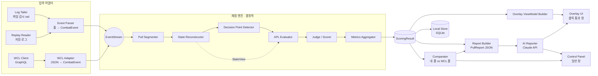
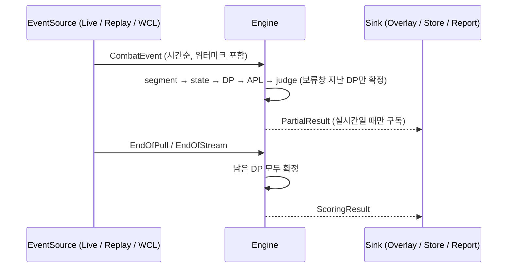

# ARCHITECTURE — RotationCoach

> 상태: 기획 초안 v0.1 (2026-10-16)
> 전제: Python 단일 언어 + PySide6 오버레이 ([TECH_DECISIONS §1, §2](TECH_DECISIONS.md)). 언어가 바뀌어도 모듈 경계와 스키마는 그대로 유지하도록 설계했다.

## 1. 설계 원칙

1. **판정은 코드, 설명은 AI.** 엔진은 결정적(deterministic) 순수 계산이다. 같은 이벤트열과 같은 설정이면 언제나 같은 `ScoringResult`가 나온다. LLM은 이 결과를 읽고 설명만 한다.
2. **하나의 엔진, 여러 입력.** 로컬 실시간 로그, 저장된 로그 재생, WCL 이벤트는 모두 입력 어댑터에서 `CombatEvent`로 정규화한 뒤 **같은 코드 경로**로 처리한다. 실시간 모드는 "이벤트가 천천히 도착하는 재생"일 뿐이다.
3. **불확실성은 숨기지 않고 값으로 다룬다.** 로그로 알 수 없는 상태(확률 발동 쿨 초기화 등)는 구간 값으로 표현하고, 그 불확실성이 판정을 바꿀 수 있으면 "불확정"으로 판정한다 (억지로 정답/오답을 매기지 않음).
4. **스펙 지식은 데이터와 플러그인으로 분리.** 주문 ID, 지속시간, APL 텍스트, 표현식 매핑, 동률 그룹, 가중치는 `specs/hunter_survival/` 아래에 두고 코어 엔진은 전문화를 모른다.
5. **풀 종료 직후가 주 경로.** WoW는 전투 중 로그를 메모리에 모았다가 전투 종료 때 몰아서 쓰는 것으로 보고됐다 ([TECH_DECISIONS 부록 A.3](TECH_DECISIONS.md#a3-기록flush-동작)). 그래서 엔진은 "한 번에 수천 줄이 도착하는 배치"를 기본 입력 모양으로 가정하고 최적화한다. 전투 중 조금씩 도착하는 경우는 같은 코드가 작은 배치로 처리할 뿐이다.
6. **ToS 제약을 타입으로 강제.** 오버레이로 가는 데이터 계약(`OverlayViewModel`)에는 "다음 행동" 정보가 들어갈 자리가 없다. 오버레이 창은 입력을 받지 않는 창 스타일만으로 생성된다.

## 2. 전체 구성



### 2.1 프로세스·스레드 모델 (단일 프로세스)

| 스레드 | 담당 | 통신 |
|---|---|---|
| Qt 메인 스레드 | 오버레이, 제어판, 트레이 | ViewModel을 Qt 시그널(queued connection)로 받음 |
| Ingest 스레드 | 파일 감시, tail, 줄 분리, 사전 필터, 파싱 | `queue.SimpleQueue[CombatEvent]` → 엔진 |
| Engine 스레드 | 분할 → 상태 → DP → APL → 판정 → 집계 | 결과를 시그널로 UI에, 풀 종료 시 Report 작업 큐에 |
| Network 워커 (asyncio 루프 1개) | Claude API, WCL API, 토큰 갱신 | `concurrent.futures`로 엔진/UI와 교환 |

엔진 스레드는 네트워크를 절대 기다리지 않는다. AI·WCL 실패는 엔진에 영향을 주지 않는다 (FR-44).

> 오버레이를 나중에 다른 기술(Electron 등)로 바꿔야 하면, ViewModel을 로컬 WebSocket(127.0.0.1)으로 내보내는 `ViewModelPublisher`만 추가하면 된다. 엔진은 바뀌지 않는다.

## 3. 주요 데이터 구조 (스키마)

표기는 Python `dataclass` 기준. 직렬화는 JSON (snake_case). 모든 시간은 **정수 밀리초**.

### 3.1 CombatEvent (정규화 이벤트)

```python
class EventKind(StrEnum):
    CAST_START = "cast_start"; CAST_SUCCESS = "cast_success"; CAST_FAILED = "cast_failed"
    AURA_APPLIED = "aura_applied"; AURA_REMOVED = "aura_removed"; AURA_REFRESH = "aura_refresh"
    AURA_DOSE_ADDED = "aura_dose_added"; AURA_DOSE_REMOVED = "aura_dose_removed"
    DAMAGE = "damage"; PERIODIC_DAMAGE = "periodic_damage"; MISSED = "missed"
    HEAL = "heal"; ENERGIZE = "energize"; DRAIN = "drain"
    SUMMON = "summon"; UNIT_DIED = "unit_died"; INTERRUPT = "interrupt"
    ENCOUNTER_START = "encounter_start"; ENCOUNTER_END = "encounter_end"
    COMBATANT_INFO = "combatant_info"; ZONE_CHANGE = "zone_change"; MAP_CHANGE = "map_change"
    LOG_HEADER = "log_header"; UNKNOWN = "unknown"

@dataclass(frozen=True, slots=True)
class UnitRef:
    guid: str                 # 로컬: 원본 GUID / WCL: "wcl:{report}:{actorId}" 합성 GUID
    name: str | None
    kind: Literal["player", "pet", "guardian", "npc", "unknown"]
    owner_guid: str | None    # 펫·소환수의 주인
    hostile: bool | None      # 유닛 플래그(로컬) 또는 actor 정보(WCL)에서 유도

@dataclass(frozen=True, slots=True)
class PowerSample:
    power_type: int           # 2 = Focus (Enum.PowerType)
    current: int
    maximum: int
    cost: int | None

@dataclass(frozen=True, slots=True)
class AdvancedInfo:           # 고급 전투 로그 블록 (해당 이벤트가 가진 경우)
    unit_guid: str            # 블록이 설명하는 유닛
    hp: int; max_hp: int
    powers: tuple[PowerSample, ...]
    x: float; y: float; map_id: int; facing: float
    level_or_ilvl: int | None

@dataclass(frozen=True, slots=True)
class CombatEvent:
    t: int                    # 절대 시각 epoch ms (로컬: 로그 타임스탬프, WCL: report.startTime + timestamp)
    seq: int                  # 원본 내 순번. 같은 t 안에서 정렬 안정화
    kind: EventKind
    src: UnitRef | None
    dst: UnitRef | None
    spell_id: int | None
    aura_type: Literal["BUFF", "DEBUFF"] | None
    stacks: int | None
    amount: int | None        # 피해·치유·자원 획득량
    adv: AdvancedInfo | None
    extra: Mapping[str, Any]  # failed_reason, encounter_id, difficulty, success, talents 등 종류별 필드
    origin: Literal["local", "wcl"]
    raw_ref: str | None       # 로컬: "파일명:줄번호", WCL: "report:fight:index" (디버깅·근거 추적)
```

- 주문은 **ID로만** 식별한다. 로그의 주문 이름은 클라이언트 언어(한국어)로 기록되므로 이름은 표시용으로만 쓴다.
- 로그 포맷의 세부 필드 대응은 [§4.2](#42-event-parser-이벤트-파서)와 [TECH_DECISIONS 부록 A](TECH_DECISIONS.md#부록-a-전투-로그-포맷-요약).

### 3.2 StateView (상태 조회 인터페이스)

APL 평가기는 상태를 직접 들여다보지 않고 이 인터페이스로만 묻는다. 모든 수치는 불확실성을 담을 수 있다.

```python
@dataclass(frozen=True, slots=True)
class U:                      # Uncertain value
    lo: float
    hi: float
    src: Literal["observed", "inferred", "assumed"]
    @property
    def certain(self) -> bool: return self.lo == self.hi

class StateView(Protocol):
    t: int
    def buff(self, key: str) -> AuraView: ...        # up, remains: U, stack: U, react
    def debuff(self, key: str, target: str = "target") -> AuraView: ...
    def cooldown(self, key: str) -> CooldownView: ... # remains: U, charges: U, charges_fractional: U,
                                                      # full_recharge_time: U, ready: U(0/1)
    def resource(self, kind: str) -> ResourceView: ...# current: U, max, deficit: U, regen: U, time_to_max: U
    def gcd(self) -> GcdView: ...                     # remains: U, duration (가속 반영)
    def talent(self, key: str) -> int: ...            # 순위 (0 = 없음)
    def hero_tree(self) -> str | None: ...            # "pack_leader" | "sentinel"
    def target(self) -> TargetView: ...               # time_to_die: U, health_pct: U, distance: U | None
    def active_enemies(self) -> U: ...
    def prev_gcd(self, n: int) -> str | None: ...
    def in_flight(self, action_key: str) -> U: ...
```

`key`는 스펙 데이터의 이름(`kill_command`, `tip_of_the_spear` 등)이며 주문 ID 대응은 `spells.yaml`이 담당한다.

### 3.3 DecisionPoint

```python
@dataclass(frozen=True, slots=True)
class DecisionPoint:
    id: str                   # "{pull_id}:{index}"
    t_ready: int              # 플레이어가 행동 가능해진 시각 = max(직전 GCD 종료, 직전 시전 종료)
    t_action: int | None      # 실제 GCD 시전 시각 (공백 GCD면 None)
    actual: str | None        # 실제 시전 action key
    off_gcd_between: tuple[str, ...]   # 이 DP와 다음 DP 사이 GCD 없는 스킬 사용
    context: frozenset[str]   # {"moving", "out_of_range", "no_target", "dead", "cc", "excluded_phase"}
```

### 3.4 AplEvaluation

```python
@dataclass(frozen=True, slots=True)
class CandidateTrace:
    action: str               # action key
    list_path: tuple[str, ...]# ("default", "plst") — call_action_list 경로
    line_no: int              # APL 원문 줄 번호
    condition_src: str        # 원문 조건식
    result: Literal["true", "false", "unknown"]
    unknown_terms: tuple[str, ...]
    usable: Literal["yes", "no", "unknown"]   # 쿨·자원·사거리 판단

@dataclass(frozen=True, slots=True)
class AplEvaluation:
    t_eval: int
    horizon: Literal["at_ready", "reaction_shifted"]   # SCORING_SPEC §3.1
    top: str | None           # 최우선 실행 가능 행동
    tie_set: frozenset[str]   # 사실상 동률 허용 집합 (top 포함)
    ranked: tuple[CandidateTrace, ...]   # top에 도달하기까지 검사한 줄들 (근거)
    determinate: bool         # 불확실 값이 결과를 바꿀 수 있으면 False
```

### 3.5 Judgement

```python
class Verdict(StrEnum):
    MATCH = "match"; ACCEPTABLE = "acceptable"; MINOR = "minor"; MISTAKE = "mistake"
    IDLE = "idle"; EXCLUDED = "excluded"; INDETERMINATE = "indeterminate"

@dataclass(frozen=True, slots=True)
class Judgement:
    dp_id: str
    verdict: Verdict
    expected: str | None      # APL top
    accepted: frozenset[str]  # 허용된 행동 집합
    actual: str | None
    weight: float             # 이 DP의 중요도 (SCORING_SPEC §4.2)
    credit: float             # 0.0 ~ 1.0
    reasons: tuple[str, ...]  # 기계 판독용 사유 코드 (예: "reaction_window", "tie_group:raptor_mongoose")
    evidence: EvidenceRef     # APL 줄, 상태 스냅샷 해시, raw_ref 목록
```

### 3.6 PullScore / ScoringResult

```python
@dataclass(frozen=True, slots=True)
class PullMeta:
    pull_id: str; source: Literal["local", "wcl"]; source_ref: str
    encounter_id: int | None; encounter_name: str | None; difficulty: int | None
    t_start: int; t_end: int; kill: bool | None
    player: UnitRef; spec_id: int; hero_tree: str | None; talents_hash: str

@dataclass(frozen=True, slots=True)
class Metrics:
    score: float                    # 0~100 (SCORING_SPEC §4)
    apl_match_rate: float           # (MATCH+ACCEPTABLE) / 판정 가능 DP
    dp_counts: Mapping[Verdict, int]
    active_time_pct: float          # GCD 사용 시간 / 채점 대상 시간
    idle_gcd_seconds: float
    cooldowns: Mapping[str, CdUsage]  # 사용 횟수, 이론 최대, 평균 지연, 버린 시간
    resource_overcap_seconds: float # 집중 최대치 유지 시간
    charge_cap_seconds: Mapping[str, float]
    buff_uptime: Mapping[str, float]
    spec_specific: Mapping[str, float]  # 예: tip_of_the_spear 소모율

@dataclass(frozen=True, slots=True)
class ScoringResult:
    meta: PullMeta
    metrics: Metrics
    judgements: tuple[Judgement, ...]
    timeline: tuple[TimelineEntry, ...]   # 시전·주요 버프·쿨다운 사용 타임라인 (비교·리포트용)
    excluded_spans: tuple[Span, ...]
    warnings: tuple[str, ...]             # 모르는 표현식, 로그 버전 불일치 등
    versions: Versions                    # engine, spec_data, apl_commit, log_version, scoring_spec
```

### 3.7 PullReport (LLM 입력)

`ScoringResult`에서 LLM에 필요한 부분만 골라 크기를 제한한 JSON. 원본 로그 줄은 포함하지 않는다.

```jsonc
{
  "schema": "pull_report/1",
  "meta": {"encounter": "…", "difficulty": "heroic", "duration_s": 312.4, "kill": true,
           "hero_tree": "sentinel", "apl_commit": "abc1234"},
  "metrics": {"score": 78.5, "apl_match_rate": 0.83, "active_time_pct": 0.95, "...": "..."},
  "top_issues": [            // 엔진이 손실 가중치 순으로 고른 상위 N개 패턴 (AI가 고르지 않음)
    {"id": "I1", "pattern": "kill_command_overcap", "count": 7, "weight_sum": 5.2,
     "examples": ["dp:42", "dp:88"], "explain_hint": "tip_of_the_spear 0중첩 상태에서 …"}
  ],
  "cooldowns": [{"key": "coordinated_assault", "uses": 2, "max_uses": 3, "avg_delay_s": 14.2}],
  "judgement_samples": [     // 대표 DP만, 근거 포함
    {"id": "dp:42", "t_rel_s": 37.2, "verdict": "mistake", "expected": "kill_command",
     "actual": "raptor_strike", "state": {"focus": 42, "tip_of_the_spear": 0, "...": "..."},
     "apl_line": "kill_command,if=…"}
  ],
  "comparison": null,        // WCL 비교 시 ComparisonReport 요약
  "glossary_ref": "ko/hunter_survival@v1"   // 시스템 프롬프트 쪽 용어집 버전
}
```

크기 목표: 빠른 요약 입력 ≤ 6k 토큰, 상세 해설 입력 ≤ 30k 토큰.

### 3.8 OverlayViewModel

```python
@dataclass(frozen=True, slots=True)
class OverlayViewModel:
    mode: Literal["idle", "in_combat", "post_pull"]
    pull_label: str | None
    elapsed_s: float | None
    score: float | None
    apl_match_rate: float | None
    mistakes: int; idle_gcds: int; indeterminate: int
    cd_efficiency: float | None
    overcap_seconds: float | None
    data_lag_s: float | None        # 로그 도착 지연 (FR-35)
    summary_lines: tuple[str, ...]  # post_pull 전용: 규칙 기반 요약 + AI 빠른 요약
    ai_status: Literal["none", "pending", "ready", "failed"]
    # 의도적으로 없는 필드: next_action, recommended_action, upcoming_cooldown 등
```

- 전투 중(`in_combat`)에는 누적 수치만 채워진다. `summary_lines`는 `post_pull`에서만 채운다 (C-3, 결정 D-4).
- 단위 테스트로 "in_combat 상태 ViewModel에 주문 이름이 들어가지 않는다"를 검사한다.

### 3.9 ComparisonReport

```python
@dataclass(frozen=True, slots=True)
class ComparisonReport:
    mine: PullMeta; other: PullMeta
    alignment: Literal["pull_relative", "phase_relative"]
    metrics_diff: Mapping[str, tuple[float, float]]          # (내 값, 비교 값)
    cd_timeline: Mapping[str, tuple[tuple[float, ...], tuple[float, ...]]]  # 쿨다운별 사용 시각(초)
    cast_count_diff: Mapping[str, tuple[int, int]]
    pattern_diff: tuple[PatternDiff, ...]                    # 상위 실수 패턴 비교
    caveats: tuple[str, ...]                                 # 특성·장비·전투 시간 차이 등
```

## 4. 모듈 설계

### 4.1 Log Tailer (로그 tailer)

- **입력**: WoW `Logs` 디렉터리 경로 (설정). **출력**: 완성된 줄 + (파일 ID, 바이트 오프셋, 도착 시각).
- 동작
  1. 디렉터리에서 `WoWCombatLog*.txt` 중 수정 시각이 가장 최근인 파일을 고른다. 파일 생성·이름 변경은 `ReadDirectoryChangesW`(watchdog) + 1 s 주기 폴링 이중화로 감지한다.
  2. 파일을 **공유 모드**로 열어 게임의 쓰기를 방해하지 않는다 (읽기 전용, 쓰기·삭제 공유 허용). [SPIKES S7](SPIKES.md#s7-windows-파일-tail-견고성)에서 확인.
  3. 50 ms 주기로 크기를 확인하고 새 바이트를 읽는다. 마지막 줄바꿈 이후 조각은 다음 읽기까지 보관한다 (FR-03).
  4. 크기가 줄어들면(잘림) 처음부터 다시 읽고, 새 파일이 생기면 기존 파일을 끝까지 읽은 다음 전환한다.
  5. 줄마다 **도착 시각**(`time.monotonic_ns()` → wall clock 보정)을 기록해 로그 기록 지연(NFR-L3)을 계산한다.
  6. **배치 감지와 재정렬**: 한 번의 읽기로 들어온 줄 묶음을 배치로 보고, 파일 크기가 `quiet_ms`(기본 500 ms) 동안 변하지 않으면 배치 종료로 본다. 일괄 기록된 줄은 시간순이 아닐 수 있다는 보고가 있으므로 [2차] 배치 안에서 타임스탬프 기준 안정 정렬한 뒤 파서로 넘긴다. 배치 경계를 넘는 역순 줄은 `reorder_window`(기본 5 s) 안에서만 받아들이고 그 밖은 경고 집계.
- 인터페이스

```python
class LineSource(Protocol):
    def lines(self) -> Iterator[RawLine]: ...   # 블로킹 이터레이터, stop()으로 종료
@dataclass(frozen=True, slots=True)
class RawLine:
    text: str; file_id: str; offset: int; arrived_at_ms: int
```

### 4.2 Event Parser (이벤트 파서)

- **입력**: `RawLine`. **출력**: `CombatEvent`.
- 2단계 처리
  1. **사전 필터 (빠른 경로)**: 대상 플레이어 GUID, 그 펫 GUID 집합, 풀 경계 이벤트(`ENCOUNTER_*`, `COMBATANT_INFO`, `ZONE_CHANGE`, `COMBAT_LOG_VERSION`), 대상 적 GUID(현재 목표 추정용)가 줄에 들어 있는지 부분 문자열 검사만 한다. 레이드 로그 대부분은 다른 플레이어 줄이므로 여기서 버린다.
  2. **토크나이저**: 타임스탬프와 본문을 분리하고(구분자는 공백 2개, 가끔 탭), 본문을 쉼표로 나누되 큰따옴표 문자열과 `[]`, `()` 중첩(`COMBATANT_INFO`)을 고려한다. 이벤트별 필드 위치는 **버전별 레이아웃 테이블**(`parse/layouts/v{N}.py`)로 관리한다.
- 타임스탬프는 `M/D/YYYY H:MM:SS.fff±H`(연도와 UTC 오프셋 포함, 0 채움 없음) 형식이 현재 형식으로 보고됐고, 예전 형식 `MM/DD HH:MM:SS.fff`도 받아들인다 ([부록 A.2](TECH_DECISIONS.md#a2-줄-형식)).
- 이벤트 이름 접두어(`SPELL_`, `SPELL_PERIODIC_`, `SWING_`, `RANGE_`) + 접미어(`_DAMAGE`, `_AURA_APPLIED` …) 조합으로 해석한다.
- **고급 블록은 필드 개수로 판별한다.** 헤더의 `ADVANCED_LOG_ENABLED`는 참고만 한다 (잘린 로그에서는 헤더가 없을 수 있음). 고급 블록의 필드 수 자체도 출처마다 17개/19개로 다르게 보고되므로 [부록 A.2], 레이아웃은 S2 실측 로그로 확정하고 **필드 수 불일치는 버전 경고**로 처리한다.
- `COMBAT_LOG_VERSION` 줄이 파일 중간에 다시 나오면(로깅 재시작) 파서·분할기 상태를 초기화한다.
- 고급 블록이 설명하는 유닛은 이벤트마다 다르다: `SPELL_CAST_SUCCESS`는 시전자, `SPELL_DAMAGE`·`SPELL_ENERGIZE` 등은 대상 [2차]. 그래서 **플레이어 자신의 집중 값은 주로 `SPELL_CAST_SUCCESS`와 자기 대상 `SPELL_ENERGIZE`에서 관측**된다 (S2에서 확인).
- 모르는 이벤트는 `UNKNOWN`으로 만들고 집계만 한다 (NFR-M1).
- 로그 포맷 세부와 출처: [TECH_DECISIONS 부록 A](TECH_DECISIONS.md#부록-a-전투-로그-포맷-요약).

### 4.3 WCL Client / WCL Adapter

- **WCL Client**: OAuth 토큰 관리, GraphQL 호출, 페이지네이션(`nextPageTimestamp`), 요청 한도 확인(`rateLimitData`), SQLite 응답 캐시. 세부는 [TECH_DECISIONS §4](TECH_DECISIONS.md#4-wcl-연동).
- **WCL Adapter**: `masterData.actors`로 actor ID ↔ 이름·종류·펫 주인을 매핑하고, 이벤트 JSON을 `CombatEvent`로 변환한다.

| WCL `type` | `EventKind` |
|---|---|
| `begincast` / `cast` | `CAST_START` / `CAST_SUCCESS` |
| `applybuff`, `applydebuff` | `AURA_APPLIED` (+`aura_type`) |
| `removebuff`, `removedebuff` | `AURA_REMOVED` |
| `refreshbuff`, `refreshdebuff` | `AURA_REFRESH` |
| `applybuffstack` / `removebuffstack` | `AURA_DOSE_ADDED` / `AURA_DOSE_REMOVED` |
| `damage` (`tick: true`면 periodic) | `DAMAGE` / `PERIODIC_DAMAGE` |
| `resourcechange` | `ENERGIZE` |
| `summon`, `death`, `combatantinfo` | `SUMMON`, `UNIT_DIED`, `COMBATANT_INFO` |

- 자원 값은 `includeResources: true`로 받은 `classResources`를 `AdvancedInfo.powers`로 옮긴다.
- WCL이 만들어 넣는 가상 이벤트(풀 시작 시 이미 걸려 있던 버프 등, 응답에서 표시되는 경우)는 `extra["synthetic"]=True`로 표시한다. 필드 이름은 [SPIKES S5](SPIKES.md#s5-wcl-api-v2-연동과-이벤트-동등성)에서 확정.
- **동등성 테스트**: 같은 풀의 로컬 로그와 WCL 업로드본을 각각 정규화해 이벤트 단위로 비교하는 도구(`tools/parity_check.py`)를 둔다 (NFR-A8).

### 4.4 Pull Segmenter (풀 분할기)

| 상황 | 시작 | 종료 |
|---|---|---|
| 레이드·던전 보스 | `ENCOUNTER_START` | `ENCOUNTER_END` (성공 여부 포함) |
| 허수아비·야외 | 대상 플레이어가 적대 유닛에 첫 피해/시전 | 마지막 공격 후 `idle_gap`(기본 5 s) 경과 또는 오라 대량 제거·사망·지역 변경 |
| WCL | `fights[].startTime` | `fights[].endTime` |

- `COMBATANT_INFO`는 `ENCOUNTER_START`·`CHALLENGE_MODE_START` 뒤에만 기록되고 일반 몹·허수아비 전투에서는 나오지 않는다고 보고됐다 [2차]. 그래서 **허수아비 풀의 특성은 설정에 저장한 "특성 프로필"**(직전 레이드 풀의 `COMBATANT_INFO`를 자동 저장하거나, 사용자가 영웅 특성·핵심 특성을 직접 체크)을 쓴다. 관측된 주문(예: Moonlight Chakram 시전 → 파수꾼, Howl 관련 오라 → 무리의 지도자)으로 영웅 특성을 교차 검증하고, 모순되면 경고한다. 이 동작은 [SPIKES S2](SPIKES.md#s2-생존-사냥꾼-핵심-상태를-로그만으로-재구성할-수-있는가)에서 확인.
- 실시간 모드에서는 풀 진행 중에도 부분 결과를 낸다. 종료가 확정되면 `PullFinalized` 이벤트를 발행한다.

### 4.5 State Reconstructor (상태 재구성기)

- **입력**: 풀 안의 `CombatEvent` (시간순). **출력**: 임의 시각 `t`의 `StateView` + 상태 변화 로그.
- 구성 요소
  - `AuraTracker`: 대상 플레이어(와 펫)에 걸린 오라, 목표 적의 플레이어 디버프. 지속시간은 `spells.yaml` 기본값 + 관측된 적용·제거 간격으로 학습해 보정한다. 판다믹(최대 130%) 갱신 규칙 지원.
  - `CooldownTracker`: 시전 기록 + `spells.yaml`의 기본 쿨다운·충전 수·가속 영향 여부 + **쿨다운 변경 규칙**(스펙 어댑터가 등록: "X 적중 시 Y 쿨 Z초 감소", "확률로 X 초기화" 등)으로 준비 시각을 계산한다. 불확정 규칙이 끼면 준비 시각이 구간 `[lo, hi]`가 된다. 나중에 실제 시전으로 "이 시각엔 준비돼 있었다"가 확인되면 **과거 구간을 좁힌다**(사후 보정, [SCORING_SPEC §6.2](SCORING_SPEC.md#62-지연-판정lookahead)).
  - `ResourceTracker`: 고급 블록의 `currentPower`를 관측값으로 쓰고, 관측 사이는 재생률(관측으로 추정, 가속 반영) × 경과 시간으로 보간한다.
  - `HasteEstimator`: `COMBATANT_INFO`의 가속 수치 + 가속 버프(블러드 계열 등) + 연속 시전 간격의 하한선으로 GCD 길이를 추정한다.
  - `ContextTracker`: 이동(위치 변화), 사거리 이탈(실패 사유 이벤트, 위치 거리), 대상 없음(적대 대상에 대한 피해 공백), 사망을 판정한다.
  - `TargetTracker`: 주 목표 GUID(최근 직접 공격 대상), 목표 체력 비율(고급 블록), 사망 예상 시간(체력 감소 추세).
- 구현 방식: 이벤트를 받을 때마다 증분 갱신하고, 결정 지점에서 `snapshot(t)`로 불변 `StateView`를 만든다. 사후 보정이 일어나면 아직 판정이 확정되지 않은(보류창 안의) DP만 다시 평가한다.

### 4.6 Decision Point Detector

- GCD를 쓰는 대상 플레이어의 `CAST_SUCCESS`(시전 시간 있는 스킬은 `CAST_START`)마다 DP를 만든다. `t_ready`는 직전 GCD 종료와 직전 시전 종료 중 늦은 쪽이다.
- 직전 GCD가 끝나고 `idle_threshold`(기본: GCD 길이 + 반응 허용 시간) 동안 아무 GCD도 없으면 **공백 DP**(`t_action=None`)를 만든다.
- GCD 여부·시전 시간은 `spells.yaml`에서 가져온다. GCD 없는 스킬(off-GCD)은 DP를 만들지 않고 인접 DP의 `off_gcd_between`에 붙인다 ([SCORING_SPEC §3.6](SCORING_SPEC.md#36-gcd-없는-스킬off-gcd)).

### 4.7 APL Evaluator (APL 평가기)

선택한 방식은 **SimC APL 부분 인터프리터 + 스펙 어댑터**(혼합안)이다. 비교와 근거는 [TECH_DECISIONS §3](TECH_DECISIONS.md#3-apl-처리-방식).

```
specs/hunter_survival/apl/hunter_survival.simc   (SimC 커밋 고정 원문)
          │  lexer/parser (실행 시 1회)
          ▼
   AplProgram (AST: action list → 줄 → action + 옵션(if=, target_if=, line_cd=, …))
          │  바인딩: 표현식 항(term)을 TermRegistry에서 찾아 StateView 조회 함수로 연결
          ▼
   BoundProgram ──evaluate(StateView)──▶ AplEvaluation
```

- **3값 논리**: 조건식은 `true / false / unknown`으로 평가한다. 비교 연산에 불확실 값 `U(lo, hi)`가 들어가면 lo·hi 양쪽으로 계산해 결과가 같으면 확정, 다르면 `unknown`이다.
- **top 결정**: 위에서부터 줄을 검사해 조건이 `true`이고 사용 가능한 첫 행동이 top이다. top보다 위에 `unknown` 줄이 있으면 `determinate=False`이며, 그 `unknown` 줄의 행동들도 허용 후보에 넣는다 ([SCORING_SPEC §2](SCORING_SPEC.md#2-판정-분류)).
- **지원 구문**: `actions.X+=/`, `call_action_list`, `run_action_list`, `variable`(op=set/reset/max/min/setif), `if=`, `line_cd=`, `target_if=`(단일 대상에선 현재 목표로 축약), `use_off_gcd=`, `use_while_casting=`, 산술·비교·논리 연산자, `&`, `|`, `!`, `<?`, `>?`(min/max), `%`(SimC에서는 나눗셈), `%%`(나머지).
- **무시/대체 구문**: 아이템·장신구(`use_item`), 물약, 종족 특성, `snapshot_stats`, 펫 소환 같은 비채점 행동은 평가 대상에서 빼거나 off-GCD로 분류한다 (스펙 어댑터의 `ignore_actions`).
- **TermRegistry**: `buff.X.up`, `cooldown.X.remains`, `focus.deficit`, `talent.X`, `hero_tree.X`, `target.time_to_die`, `active_enemies`, `prev_gcd.1.X`, `fight_remains`, `gcd.max` 등 일반 항은 코어가 제공하고, `howl_summon.ready` 같은 전문화 고유 항은 스펙 어댑터가 등록한다. 등록되지 않은 항은 시작 시 경고하고 `unknown`으로 평가한다 (FR-25).
- **APL 패치 레이어** (`apl_patches.yaml`): 로그로 관측할 수 없거나 사람에게 불공정한 조건을 원문을 고치지 않고 덮어쓴다. 예: `target.time_to_die` 기반 조건 → 풀 종료 시각을 아는 사후 평가에서는 실제 남은 시간 사용 여부를 설정으로 선택.

### 4.8 Judge / Scorer, Metrics Aggregator

- DP마다 `AplEvaluation`을 두 번 구한다: `at_ready`(t_ready 상태)와 `reaction_shifted`(반응 시간만큼 이전 정보만 반영한 상태). 판정 규칙은 [SCORING_SPEC §3](SCORING_SPEC.md#3-gcd-단위-판정-규칙).
- 풀 종료 후 채점(주 모드)에서는 풀 전체 이벤트로 상태 증거를 모두 반영한 뒤 한 번에 판정한다. 전투 중 갱신(선택 기능)에서는 보류창(기본 2 s)이 지나야 판정을 확정하고, 확정된 판정만 지표에 반영한다 ([SCORING_SPEC §6.2](SCORING_SPEC.md#62-지연-판정lookahead)).
- 주요 쿨다운을 아끼는 연속 DP는 "보류 접기" 규칙으로 하나의 쿨다운 지연 판정으로 묶는다 ([SCORING_SPEC §3.7](SCORING_SPEC.md#37-주요-쿨다운-보류-접기-held-cooldown-collapse)).
- 집계기는 판정과 상태 로그에서 `Metrics`를 계산한다. 쿨다운 효율·자원 낭비 같은 지표는 APL과 독립으로 계산해 APL 해석 오류가 모든 지표를 오염시키지 않게 한다.

### 4.9 Overlay UI

- PySide6 `QWidget` 하나 (프레임 없음, 반투명 배경, 항상 위, 입력 투명, 포커스 없음). Win32 확장 스타일을 `ctypes`로 한 번 더 강제한다. 세부: [TECH_DECISIONS §2](TECH_DECISIONS.md#2-오버레이-기술).
- **제어판**(일반 창)과 **시스템 트레이**가 모든 상호작용을 맡는다: 위치 프리셋·오프셋, 표시 항목, 상세 해설 요청, WCL 비교 실행, 키 설정.
- 갱신은 ViewModel이 바뀔 때만, 최대 4 Hz.

### 4.10 AI Reporter

- 풀 종료(`PullFinalized`) → `ReportBuilder`가 `PullReport` 생성 → Haiku 빠른 요약 요청 → 결과 검증 → 오버레이 `summary_lines`에 추가.
- 상세 해설은 제어판 버튼으로 요청한다. Sonnet/Opus 스트리밍 결과를 제어판에 표시하고 로컬에 저장한다.
- 출력은 JSON 스키마(구조화 출력)로 받아 "근거 ID(`dp:42`, `I1`)가 입력에 있는지", "언급된 수치가 입력 수치와 같은지"를 검사한다. 실패하면 해당 문장을 버리고 표시한다 (FR-43).
- 세부(모델 역할, 캐싱, 비용): [TECH_DECISIONS §5](TECH_DECISIONS.md#5-claude-api-호출).

### 4.11 Comparator

- 두 `ScoringResult`를 받아 `ComparisonReport`를 만든다. 기본 정렬은 풀 시작 기준 상대 시간이며, 보스 단계(phase) 정보가 있으면 단계 기준으로도 정렬한다.
- 특성·영웅 특성·전투 시간·가속 차이를 `caveats`에 넣어, AI가 "조건이 다른 비교"를 설명할 수 있게 한다.

### 4.12 Local Store

- SQLite 1개 파일 (`%LOCALAPPDATA%\RotationCoach\store.db`): 풀 메타, `ScoringResult`(압축 JSON), AI 리포트, WCL 응답 캐시, 실행 로그 요약.
- 설정: `%APPDATA%\RotationCoach\config.toml` (비밀 값 없음). 비밀 값: Windows 자격 증명 관리자 ([TECH_DECISIONS §6](TECH_DECISIONS.md#6-api-키-로컬-저장-보안-검토)).

## 5. 실시간 로그와 WCL 로그를 같은 엔진으로 처리하는 구조



- `EventSource`는 `CombatEvent`와 함께 **워터마크**(이 시각 이전 이벤트는 더 오지 않음)를 낸다.
  - Live: 워터마크 = (배치 종료가 확인된 경우) 배치 안 마지막 이벤트 시각 − `reorder_window`. 로그 버퍼링 때문에 실제 도착이 늦더라도 엔진은 "로그 시간"으로만 계산하므로 결과는 재생과 같다. 전투 종료 일괄 기록이면 사실상 "풀 하나를 통째로 재생"하는 것과 같다.
  - Replay·WCL: 모든 이벤트가 즉시 있으므로 워터마크가 바로 끝까지 간다.
- 엔진은 벽시계를 쓰지 않는다. 그래서 **실시간 결과 = 같은 로그를 재생한 결과**가 보장되고, 이것이 회귀 테스트의 근거가 된다 (NFR-A7).
- WCL 입력과 로컬 입력의 차이(필드 이름, 시간 기준, actor ID)는 어댑터에서 모두 흡수한다. 엔진에 `if origin == "wcl"` 분기가 생기면 설계 위반으로 본다. 예외적으로 WCL에서 정보가 빠지는 경우(예: 실패 사유)는 `StateView`가 `unknown`을 돌려주는 방식으로만 처리한다.

## 6. 스펙 플러그인 구조

```
specs/hunter_survival/
  spec.toml            # spec_id, 지원 영웅 특성, 지원 로그 버전, 데이터 버전
  spells.yaml          # key → 주문 ID 목록, gcd, cast_time, cooldown, charges, haste_scaled, range, duration
  cd_rules.py          # 쿨다운 변경 규칙 (결정적/확률적)
  terms.py             # 스펙 고유 APL 표현식 항
  apl/hunter_survival.simc
  apl.lock             # simc 저장소 URL, 브랜치, 커밋 해시, 가져온 날짜
  apl_patches.yaml     # 관측 불가 조건 대체
  tie_groups.yaml      # 사실상 동률 집합
  weights.yaml         # 판정 가중치
  glossary_ko.yaml     # 한국어 스킬명·용어 (AI 프롬프트·UI용)
  fixtures/            # 이 스펙의 회귀 테스트 로그
```

새 전문화 추가 = 이 디렉터리 하나 추가 + `terms.py`/`cd_rules.py` 구현. 코어 수정은 없어야 한다 (NFR-M4).

## 7. 오류 처리와 관측성

| 상황 | 처리 |
|---|---|
| 파싱 실패 줄 | 건너뛰고 `parse_errors` 집계, 원문 앞 200자를 진단 로그에 |
| 지원하지 않는 로그 버전 | 경고 배너 + 실험 모드 |
| APL 미등록 항 | 시작 시 목록 경고, 해당 조건 `unknown` |
| 고급 로그 꺼짐 | 자원·위치 기반 기능 비활성 + 경고 |
| 로그 도착 지연 > 10 s | 오버레이에 지연 표시 |
| Claude/WCL 오류 | 재시도(429/5xx 지수 백오프), 실패 시 `ai_status="failed"`, 엔진 영향 없음 |

진단 지표: 줄 도착 지연 분포, 엔진 처리 시간, DP별 판정 분포, 불확정 비율. 제어판의 "진단" 탭에서 본다.
