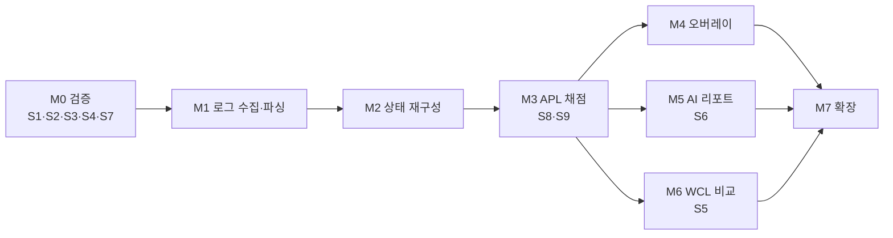

# ROADMAP — 마일스톤, 완료 기준, 테스트, 폴더 구조

> 상태: 기획 초안 v0.1 (2026-10-16)
> 원칙: 각 마일스톤은 **CLI로 먼저 결과를 확인할 수 있게** 만든다. 오버레이(M4)는 엔진이 저장된 로그로 검증된 뒤에 붙인다.
> 규모 표기: S(며칠) · M(1–2주) · L(2–4주), 1인 파트타임 기준 대략치.

## 1. 마일스톤 개요



M4·M5·M6은 M3 이후 병렬로 진행할 수 있다. 권장 순서는 M4 → M5 → M6 (매 풀마다 쓰는 기능부터).

## 2. 마일스톤별 상세

### M0 — 기술 검증 (S)

| 항목 | 내용 |
|---|---|
| 범위 | S1, S7, S2(녹화·분석), S3, S4. 선택: S6 |
| 완료 기준 | 각 스파이크 결과 문서 `spikes/results/S*.md` 작성, 성공 기준 판정. 결정 D-1, D-2, D-3 확정. TECH_DECISIONS 부록 A의 [미확인] 항목 중 S1·S2·S7 대상 해소 |
| 산출물 | 익명화한 샘플 로그 3개 이상 (무리의 지도자 허수아비, 파수꾼 허수아비, 보스 1) → `tests/fixtures/logs/` |
| 중단 조건 | S1에서 "어디서나 30 s 초과" → 제품 형태 재논의 후 진행 |

### M1 — 로그 수집·파싱 (M)

| 항목 | 내용 |
|---|---|
| 범위 | `ingest/tailer`, `parse/tokenizer`, `parse/layouts/v22`, `CombatEvent`, `ReplaySource`, `PullSegmenter`(기본), 익명화 도구 `tools/anonymize_log.py`, CLI `rc events <log> [--player NAME] [--pull N]` |
| 완료 기준 | ① 고정 샘플 로그의 모든 줄 파싱, 모르는 이벤트 0이 아니면 목록 보고 ② 대상 이벤트 유형 필드 값이 손으로 확인한 기대값과 일치 ③ 풀 분할이 수동 확인 결과와 일치 ④ 사전 필터 포함 재생 ≥ 200k 줄/초 (NFR-R6) ⑤ tailer가 S7 시나리오(새 파일·잘림·부분 줄·배치·역순)를 모의 작성기 테스트로 통과 |
| 테스트 | 단위: 토크나이저(따옴표·중첩·`|` 다중 자원), 타임스탬프(오프셋·연도 없는 형식·자정). 속성 테스트(hypothesis): 무작위 필드 생성 → 직렬화 → 파싱 왕복. 고정 데이터: 샘플 로그 → 이벤트 개수·종류 분포 스냅샷. 통합: `tests/tools/fake_wow_writer.py`가 실제 로그를 배치·지연·역순으로 다시 써서 tailer 검증 |

### M2 — 상태 재구성 (M)

| 항목 | 내용 |
|---|---|
| 범위 | `AuraTracker`, `CooldownTracker`(충전·가속·`cd_rules`), `ResourceTracker`, `HasteEstimator`, `ContextTracker`, `TargetTracker`, `StateView`, `specs/hunter_survival/spells.yaml`(simc 데이터에서 반자동 생성), 특성 프로필, CLI `rc state <log> --pull N --at 37.2` / `--timeline` |
| 완료 기준 | ① 로그에 나온 오라의 있음/없음·중첩이 모든 시점에서 이벤트와 일치 (NFR-A2) ② Kill Command·Wildfire Bomb 준비 시각 예측 오차가 S2 기준 이내 (NFR-A3) ③ 모델 불확실성이 있는 값은 구간으로 나오고, 실제 시전으로 구간이 좁혀짐 ④ 두 영웅 특성 샘플 모두 동작 |
| 테스트 | 단위: 각 트래커를 합성 이벤트열로 (판다믹 갱신, 충전 회복, 감소 효과 연쇄, 가속 변화). 고정 데이터: 샘플 로그의 특정 시점 상태 스냅샷(JSON). S8b 변환 데이터로 SimC 내부 상태와 비교 |

### M3 — APL 채점 (L)

| 항목 | 내용 |
|---|---|
| 범위 | `apl/lexer·parser·evaluator`(3값 논리), `TermRegistry` + 생존 `terms.py`, `apl.lock`·`apl_patches.yaml`·`tie_groups.yaml`·`weights.yaml`, `DecisionPointDetector`, `Judge`(SCORING_SPEC 전체 규칙), `MetricsAggregator`, `ScoringResult` 저장, CLI `rc score <log> [--pull N] [--explain dp:42]`, `tools/apl_update.py` |
| 완료 기준 | ① S8a 일치 ≥ 98% (NFR-A4) ② S9 사람 라벨 일치 ≥ 90% (NFR-A5) ③ 단일 대상 풀 불확정 ≤ 10% (NFR-A6) ④ 같은 입력 반복 실행 결과 바이트 동일 (NFR-A7) ⑤ 모든 판정에 근거 기록 ⑥ APL 갱신 도구가 표현식 항·줄 차이 보고 |
| 테스트 | 단위: 연산자 우선순위, 3값 논리, `call_action_list` 의미, 각 판정 규칙(반응·대기열·경계·동률·보류 접기·이동·대상 없음)을 합성 상태로. 골든: 샘플 로그 → `ScoringResult` 스냅샷 (`tests/golden/*.json`). 스냅샷 변경은 `rc golden diff`로 판정 변화 목록을 사람이 검토한 뒤에만 갱신 |

### M4 — 오버레이 (M)

| 항목 | 내용 |
|---|---|
| 범위 | `overlay/window`(PySide6 + Win32), `OverlayViewModel` 빌더, 제어판(설정·풀 목록·타임라인·진단·라벨 화면), 트레이, 실시간 파이프라인 연결(Live 소스 → 엔진 → UI), 위치 프리셋, "보조 모니터 모드" |
| 완료 기준 | ① S3 확인 항목을 완성 앱에서 재통과 ② 전투 종료(마지막 줄 도착) → 오버레이 결과 ≤ 1 s (NFR-L1) ③ `in_combat` ViewModel에 주문·행동 이름이 들어가지 않음 (자동 테스트) ④ 3시간 연속 실행 메모리 ≤ 300 MB, CPU 기준 충족 (NFR-R1, R2) ⑤ 오버레이 창 스타일 검사 테스트(`WS_EX_TRANSPARENT|NOACTIVATE|TOOLWINDOW` 존재) |
| 테스트 | 단위: ViewModel 빌더(모드별 필드 규칙). Qt 오프스크린 렌더 스냅샷(pytest-qt). Windows 전용 통합 테스트(창 스타일 비트 확인, 사용자 PC에서 실행). 장시간: 재생 소스로 3시간 분량 로그 반복 투입 |

### M5 — AI 리포트 (M)

| 항목 | 내용 |
|---|---|
| 범위 | `ReportBuilder`(PullReport, 크기 제한·익명화), `LlmClient`(Haiku 빠른 요약, Sonnet/Opus 상세 스트리밍, 캐싱, 거절·오류 처리), 출력 검증기, 자격 증명 관리자 연동, 리포트 저장·열람, 프롬프트·용어집 버전 관리 |
| 완료 기준 | ① 풀 종료 → 빠른 요약 p95 ≤ 8 s (NFR-L4) ② 검증기가 입력에 없는 ID·수치를 잡아냄 (주입 테스트) ③ 키 없음·네트워크 끊김·429·거절에서 엔진·오버레이 정상 (FR-44) ④ 캐시 적중 확인 ⑤ 로그·화면에 키가 출력되지 않음 |
| 테스트 | 단위: PullReport 크기 제한·익명화·키 정렬 직렬화(캐시 안정성). 검증기: 잘못된 출력 예제 모음. 계약 테스트: 녹화한 API 응답으로 오프라인 실행. 실호출 평가: 고정 PullReport 5종을 프롬프트 변경 시마다 실행하고 사용자 평가표 갱신 (비용 승인 후) |

### M6 — WCL 비교 (M)

| 항목 | 내용 |
|---|---|
| 범위 | `wcl/client`(토큰·GraphQL·페이지·`rateLimitData`·캐시), `wcl/adapter`, 랭킹 검색, `Comparator`, 제어판 비교 화면(타임라인 나란히, 쿨다운 사용 시점, 지표 차이), 비교 결과를 AI 상세 해설 입력으로 |
| 완료 기준 | ① 같은 풀 로컬 vs WCL 점수 차 ≤ 2점, 판정 일치 ≥ 97% (NFR-A8) ② 상위 로그 검색 → 선택 → 채점 → 비교가 제어판에서 완료 ③ 같은 리포트 재요청 시 API 호출 0 (캐시) ④ 한도 근접 시 요청 보류·안내 ⑤ 약관 확인 결과 반영 (D-9) |
| 테스트 | 계약 테스트: 녹화한 GraphQL 응답(`tests/fixtures/wcl/`)으로 어댑터 검증, 형식 변화 대비 손상된 응답 테스트. 동등성: S5 데이터로 `tools/parity_check.py` 회귀 |

### M7 — 확장 후보 (MVP 이후)

- 2마리·광역 구간 판정 (`plcleave`, `sentcleave`, `target_if`), `active_enemies` 정확도 개선
- 쐐기돌 (풀 경계 정의, `CHALLENGE_MODE_*`, 잡몹 구간)
- 보스별 단계·이탈 구간 데이터
- 다른 전문화 추가 (`specs/<class_spec>/`)
- Blizzard Assisted Combat 우선순위를 "간이 기준" 모드로
- 전투 중 갱신 (D-3 결과에 따라)

## 3. 회귀 테스트 전략 (샘플 로그 기반)

| 계층 | 데이터 | 실행 | 통과 조건 |
|---|---|---|---|
| 파서 | `tests/fixtures/logs/*.txt` (익명화, 버전별) | 매 커밋 `pytest` | 이벤트 수·종류 분포 스냅샷 일치 |
| 상태 | 같은 로그 + 시점 목록 | 매 커밋 | 상태 스냅샷 일치 |
| 채점 골든 | 같은 로그 → `tests/golden/<log>.score.json` | 매 커밋 | 바이트 동일. 다르면 판정 변화 목록 출력 |
| SimC 골든 | `tests/fixtures/simc/*.log` (S8 산출) | 매 커밋 | 일치율 ≥ 98% 유지 |
| WCL 계약 | `tests/fixtures/wcl/*.json` | 매 커밋 | 어댑터 출력 스냅샷 일치, 로컬과 동등성 기준 |
| 성능 | 큰 레이드 로그 1개 | 수동 / 주 1회 | NFR-R6, NFR-L1 |
| 실호출 AI 평가 | 고정 PullReport 5종 | 프롬프트 변경 시, 비용 승인 후 | 검증 통과율 ≥ 95%, 사용자 평가 유지 |

- **스냅샷 갱신 규칙**: 골든 파일은 `rc golden update`로만 바꾸고, 커밋 메시지에 "판정 변화 N건: 사유"를 적는다. APL·주문 데이터 갱신 커밋은 골든 변화 보고서를 같이 남긴다.
- **패치 대응 절차**: 새 패치 → S1 축약판 실행 → 새 샘플 로그 녹화·익명화 → 파서 스냅샷 확인 → `tools/apl_update.py` → `tools/spells_from_simc.py` → 골든 차이 검토 → 버전 태그.
- 테스트 전체 실행 ≤ 5분 (NFR-M5).

## 4. 제안 폴더 구조

```
RotationCoach/
├─ docs/                          # 이 기획 문서들
├─ pyproject.toml                 # uv 관리, Python 3.12+
├─ .gitignore                     # 비밀 값·원본 로그·캐시 제외
├─ src/rotationcoach/
│  ├─ app/                        # 진입점, 설정(TOML), 트레이, 제어판, 키 관리(keyring)
│  ├─ ingest/                     # tailer, 디렉터리 감시, 배치 감지·재정렬, replay 소스
│  ├─ parse/                      # 토크나이저, 이벤트 해석, layouts/v22.py …
│  ├─ model/                      # CombatEvent, UnitRef, StateView, Judgement 등 공용 스키마
│  ├─ engine/
│  │  ├─ segment.py               # Pull Segmenter
│  │  ├─ state/                   # auras, cooldowns, resources, haste, context, target
│  │  ├─ decision.py              # Decision Point Detector
│  │  ├─ apl/                     # lexer, parser, ast, evaluator(3값), terms/(코어 항)
│  │  ├─ judge.py                 # 판정 규칙
│  │  └─ metrics.py               # 집계
│  ├─ specs/
│  │  └─ hunter_survival/         # spec.toml, spells.yaml, cd_rules.py, terms.py,
│  │                              # apl/hunter_survival.simc, apl.lock, apl_patches.yaml,
│  │                              # tie_groups.yaml, weights.yaml, glossary_ko.yaml
│  ├─ report/                     # PullReport 빌더, LLM 클라이언트, prompts/, schemas/, 검증기
│  ├─ wcl/                        # client, auth, queries/*.graphql, adapter, cache, rankings
│  ├─ compare/                    # 정렬, 차이 계산, ComparisonReport
│  ├─ overlay/                    # window.py, win32.py, viewmodel.py, widgets/
│  └─ store/                      # SQLite (풀, 결과, 리포트, WCL 캐시)
├─ tools/                         # anonymize_log, apl_update, spells_from_simc, parity_check
├─ spikes/                        # 승인된 스파이크 스크립트, results/ (원본 데이터는 커밋 안 함)
└─ tests/
   ├─ unit/
   ├─ golden/                     # 채점 결과 스냅샷
   ├─ fixtures/
   │  ├─ logs/                    # 익명화 샘플 로그 (버전별)
   │  ├─ simc/                    # S8 산출
   │  └─ wcl/                     # 녹화한 GraphQL 응답
   └─ tools/                      # fake_wow_writer 등 테스트 도구
```

## 5. 결정이 필요한 항목 (전체 목록)

| ID | 결정 | 추천 / 기본안 | 근거 문서 | 언제까지 |
|---|---|---|---|---|
| **D-0** | 제품 형태: "풀 종료 직후 채점"을 주 모드로 하는 방향 전환 승인 | 승인 | REQUIREMENTS §0, RISKS T-1·P-1 | 지금 |
| **D-1** | 언어·오버레이: Python 3.12 + PySide6 | 승인 (S3로 최종 확인) | TECH_DECISIONS §1–2 | M0 끝 |
| **D-2** | APL 처리: SimC APL 부분 인터프리터 + 스펙 어댑터(혼합안) | 승인 (S4로 최종 확인) | TECH_DECISIONS §3 | M0 끝 |
| **D-3** | 전투 중 갱신 기능 | S1에서 전투 중 데이터가 안 오면 미구현. 오더라도 정책상 기본 꺼짐 | REQUIREMENTS FR-31, RISKS P-1 | M0 끝 |
| **D-4** | 전투 중에 개별 실수 내용 표시 여부 | 표시 안 함 (개수만) | REQUIREMENTS C-3 | M4 전 |
| **D-5** | 상세 해설 기본 모델 | Sonnet 5.5 (Opus 5.5는 선택) | TECH_DECISIONS §5 | S6 후 |
| **D-6** | 전역 단축키 허용 | 사용 안 함 (트레이·제어판만) | REQUIREMENTS C-4, RISKS P-4 | M4 전 |
| **D-7** | 빠른 요약에서 thinking 끄기 | S6 측정 후 | TECH_DECISIONS §5.1 | S6 후 |
| **D-8** | 프롬프트 캐시 TTL | 5분으로 시작 | TECH_DECISIONS §5.2 | M5 |
| **D-9** | WCL API 약관 원문 확인 (사용자가 브라우저로) | M6·S5 전 필수 | TECH_DECISIONS §4.4, RISKS P-5 | S5 전 |
| **D-10** | 판정 허용 오차 초기값 R 300 ms · δ 150 ms · Q 400 ms | 승인 (S9로 조정) | SCORING_SPEC §1.2, §3 | M3 |
| **D-11** | 이동 중 공백 처리 | IDLE (원거리 행동이 가능했을 때만) | SCORING_SPEC §3.3 | M3 |
| **D-12** | 동률 그룹·경미 쌍 초기 목록 (생존 이론 관점 검토) | 사용자 검토 필요 | SCORING_SPEC §3.2, §4.2 | M3 |
| **D-13** | MVP에서 2마리 이상 구간 제외 | 제외 | SCORING_SPEC §3.5 | M3 |
| **D-14** | 스파이크 스크립트 작성 승인 범위 (S1·S7·S2 분석·S3·S4부터) | 승인 요청 | SPIKES §0 | 지금 |
| **D-15** | API 키 저장: 자격 증명 관리자 + 앱 전용 작업공간·월 지출 한도 | 승인 | TECH_DECISIONS §6 | M5 전 |
